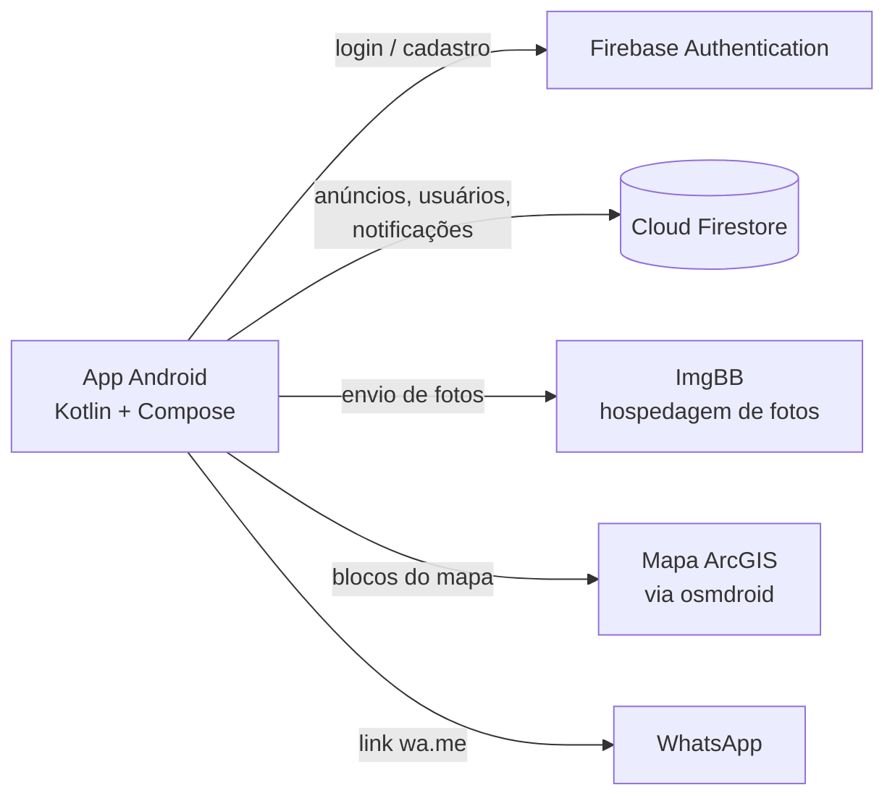
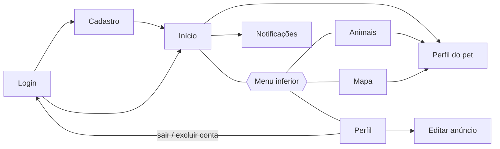
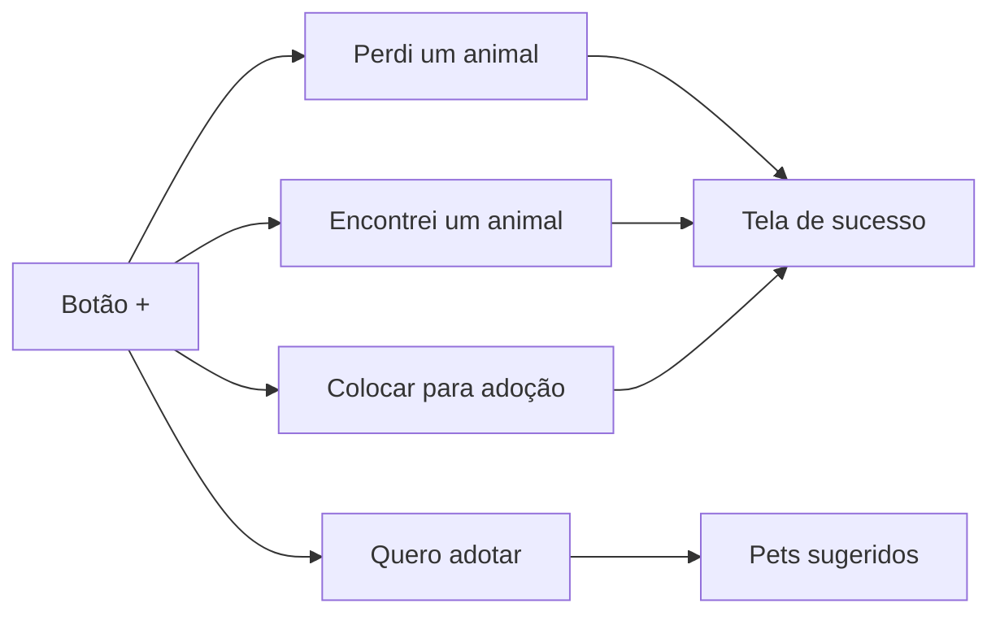

# Arquitetura

## Visão geral

O HelpPet é um aplicativo Android nativo escrito em **Kotlin**, com a interface feita em **Jetpack Compose (Material 3)**. Cada tela é uma `Activity` que desenha a interface com uma função `@Composable`. Os dados ficam no **Cloud Firestore** e a autenticação é feita pelo **Firebase Authentication**. As fotos são enviadas para o **ImgBB**, que devolve o link salvo no anúncio.

## Tecnologias e versões

| Item | Versão |
|---|---|
| Kotlin | 2.2.10 |
| Android Gradle Plugin | 9.3.3 |
| SDK mínimo / alvo | 24 (Android 7.0) / 37 |
| Jetpack Compose BOM | 2026.02.01 |
| Firebase BOM | 32.7.0 (Auth, Firestore, Messaging) |
| Google Sign-In (play-services-auth) | 20.7.0 |
| Coil (imagens) | 2.6.0 |
| OkHttp (envio de fotos) | 4.12.0 |
| osmdroid (mapa) | 6.1.18 |

## Estrutura do código

Todo o código fica em `app/src/main/java/com/example/helppet/`.

### Telas (Activities)

| Arquivo | Tela |
|---|---|
| `LoginActivity.kt` | Login com e-mail/senha e Google, recuperação de senha |
| `RegisterActivity.kt` | Cadastro de conta |
| `MainActivity.kt` | Início: saudação, busca, filtros e grade de pets |
| `AnimaisActivity.kt` | Abas Desaparecidos, Achados e Adoção |
| `MapaActivity.kt` | Mapa de pets desaparecidos |
| `PerfilActivity.kt` | Meu perfil, meus anúncios, alertas, termos e exclusão de conta |
| `DetalhesPetActivity.kt` | Perfil completo de um pet |
| `PerdiAnimalActivity.kt` | Formulário de pet perdido |
| `EncontreiAnimalActivity.kt` | Formulário de animal encontrado |
| `DoarAnimalActivity.kt` | Formulário de pet para adoção |
| `QueroAdotarActivity.kt` | Formulário de interesse em adotar e sugestões |
| `EditarAnimalActivity.kt` | Edição de um anúncio |
| `NotificacoesActivity.kt` | Notificações da comunidade e avisos privados |
| `PublicadoActivity.kt` | Tela de sucesso após publicar um anúncio |

### Componentes e lógica compartilhada

| Arquivo | Conteúdo |
|---|---|
| `Animal.kt` | Modelo de dados do anúncio |
| `MenuInferior.kt` | Menu de navegação inferior |
| `MenuAdicionarPet.kt` | Painel do botão "+" com as quatro ações |
| `ComponentesInicio.kt` | Situação do pet (`StatusPet`), cards da grade, busca, estados vazios e de carregamento, nome do usuário |
| `ComponentesFormulario.kt` | Quadro de foto ajustável, envio da foto recortada, seletor de espécie, campo de WhatsApp com máscara, seletores |
| `Compartilhar.kt` | Texto e envio do compartilhamento com foto |
| `ErrosAuth.kt` | Tradução dos erros do Firebase Auth para português |
| `FormValidator.kt` | Validação de nome do pet e telefone |
| `MyFirebaseMessagingService.kt` | Recebimento de mensagens do Firebase Cloud Messaging |

## Navegação

### Entre as telas principais

### A partir do botão "+"

Início, Animais, Mapa e Perfil são acessados pelo **menu inferior**. As telas são reutilizadas quando já estão abertas, para não acumular telas repetidas.

## Integrações

### Firebase Authentication
- E-mail e senha: `createUserWithEmailAndPassword` e `signInWithEmailAndPassword`.
- Google: Google Sign-In gera um token que é trocado por uma credencial do Firebase.
- Recuperação de senha: `sendPasswordResetEmail`.
- Os erros do Firebase são traduzidos em `ErrosAuth.kt`.

### Cloud Firestore
- As telas escutam as coleções com `addSnapshotListener`, então as listas se atualizam sozinhas.
- O formato das coleções está em [Banco de dados](banco-de-dados.md).

### Envio de fotos (ImgBB)
1. A foto escolhida é lida já reduzida, para não ocupar muita memória.
2. A rotação gravada pela câmera é corrigida.
3. A imagem é recortada no formato 4:3, conforme o enquadramento escolhido pelo usuário.
4. A largura é limitada a 1280 px e a imagem é comprimida em JPEG.
5. O arquivo é enviado ao ImgBB, e o link retornado é salvo no anúncio.

### Mapa
- osmdroid desenha o mapa com os blocos de ruas da ArcGIS.
- A posição de cada pet é **aproximada**: o app identifica o bairro citado na descrição e coloca o marcador no centro dele.
- Pets da mesma região são agrupados em um único marcador.

### WhatsApp e compartilhamento
- O contato abre `https://wa.me/55<DDD><número>` com uma mensagem pronta.
- O compartilhamento baixa a foto do pet para uma pasta temporária, a expõe com um `FileProvider` e abre a janela padrão de compartilhar do Android.

### Notificações
- Os avisos são documentos na coleção `notificacoes`. Os gerais têm `destinatarioId = "TODOS"` e os privados têm o ID do dono do pet.
- O contador do sino compara a data de cada aviso com a última vez que o usuário abriu a tela de notificações (salva no aparelho).
