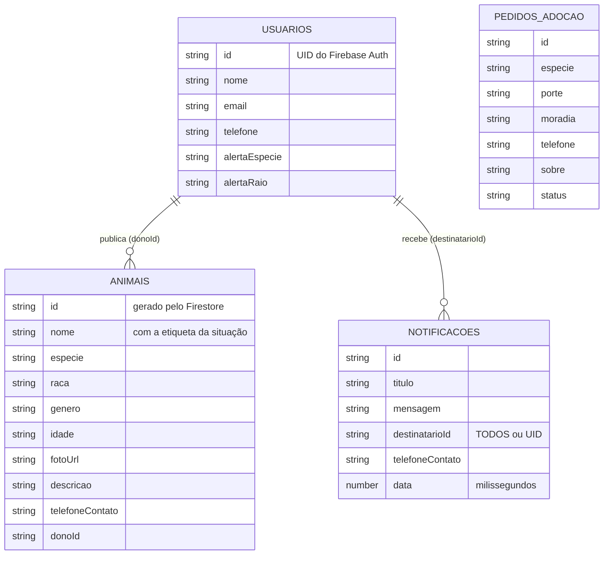

# Banco de dados

O HelpPet usa o **Cloud Firestore** (projeto Firebase `helppet-c8ac9`). Os dados ficam em quatro coleções.

## `usuarios`

Um documento por conta. O **ID do documento é o UID** do Firebase Authentication.

| Campo | Tipo | Descrição |
|---|---|---|
| `nome` | texto | Nome completo |
| `email` | texto | E-mail da conta |
| `telefone` | texto | WhatsApp informado no cadastro |
| `alertaEspecie` | texto | Espécie escolhida em "Alertas por região" (opcional) |
| `alertaRaio` | texto | Raio escolhido, ex: "50 km" (opcional) |

Contas criadas pelo login com Google recebem esse documento automaticamente no primeiro acesso.

## `animais`

Um documento por anúncio.

| Campo | Tipo | Descrição |
|---|---|---|
| `nome` | texto | Nome do pet com a etiqueta da situação, ex: "Bob (Perdido)" |
| `especie` | texto | Cachorro, Gato ou a espécie digitada |
| `raca` | texto | Raça ou, para animais encontrados, o porte ("Porte Médio") |
| `genero` | texto | Macho ou Fêmea |
| `idade` | texto | Faixa de idade (adoção) ou cor principal (encontrado) |
| `fotoUrl` | texto | Link da foto no ImgBB |
| `descricao` | texto | Detalhes. Começa com "Visto em:" (perdido), "Saúde:" (adoção) ou traz o local (encontrado) |
| `telefoneContato` | texto | WhatsApp de quem publicou, só dígitos |
| `donoId` | texto | UID de quem publicou |

### Situação do anúncio

A situação é lida pela função `statusDoAnimal` (`ComponentesInicio.kt`):

| Etiqueta no nome | Situação |
|---|---|
| "(Perdido)" ou "(Desaparecido)" | Desaparecido |
| "(Para Adoção)" | Para adoção |
| "(Está comigo)", "(Avistei na rua)", "(Encontrado - …)" | Encontrado |
| Sem etiqueta, descrição começando com "Visto em:" | Desaparecido |
| Sem etiqueta, descrição começando com "Saúde:" | Para adoção |
| Sem etiqueta e sem pista | Encontrado |

## `notificacoes`

| Campo | Tipo | Descrição |
|---|---|---|
| `titulo` | texto | Título do aviso |
| `mensagem` | texto | Texto do aviso |
| `destinatarioId` | texto | `"TODOS"` para a comunidade ou o UID do dono para avisos privados |
| `telefoneContato` | texto | WhatsApp de quem encontrou o pet (avisos privados) |
| `data` | número | Data e hora em milissegundos |

## `pedidos_adocao`

| Campo | Tipo | Descrição |
|---|---|---|
| `especie` | texto | Espécie desejada |
| `porte` | texto | Pequeno, Médio ou Grande |
| `moradia` | texto | Apartamento, casa sem quintal ou casa com quintal |
| `telefone` | texto | WhatsApp do interessado |
| `sobre` | texto | Texto livre sobre a rotina do adotante |
| `status` | texto | "Ativo" |

## Regras de segurança

As regras do Firestore exigem **usuário autenticado** para ler e gravar. Uma sugestão de regras mais restritas está em [Limitações e próximos passos](limitacoes-e-melhorias.md#segurança).
