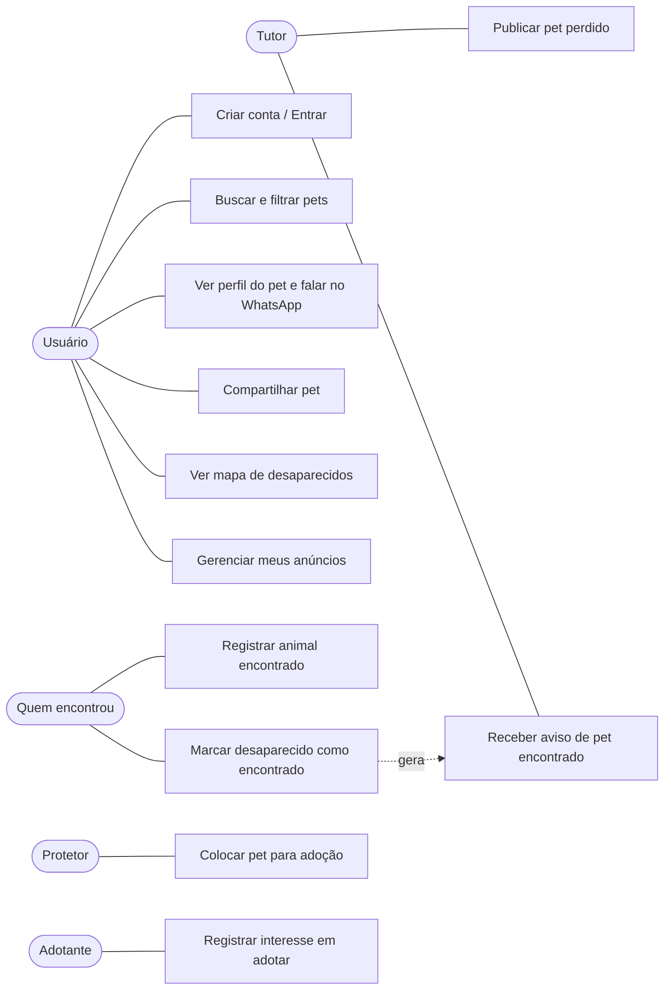

# Casos de uso

## Atores

| Ator | Descrição |
|---|---|
| **Usuário** | Qualquer pessoa com conta no app. Pode assumir os papéis abaixo conforme a situação. |
| **Tutor** | Pessoa que perdeu o seu pet ou recebe aviso de que ele foi encontrado. |
| **Quem encontrou** | Pessoa que achou ou avistou um animal na rua. |
| **Protetor** | Pessoa ou ONG que coloca um animal para adoção. |
| **Adotante** | Pessoa interessada em adotar. |
| **Firebase** | Sistema externo de autenticação e banco de dados. |

## Diagrama

## Fluxos principais

### UC07 — Publicar pet perdido
1. O tutor toca no botão **+** e escolhe **Perdi um animal**.
2. Adiciona uma foto e ajusta o enquadramento arrastando a imagem.
3. Preenche nome, espécie, gênero, raça (opcional), características e o local onde o pet foi visto por último.
4. Confere o WhatsApp (já vem preenchido com o telefone do cadastro).
5. Toca em **Registrar desaparecimento**.
6. O sistema envia a foto, salva o anúncio, cria um alerta para a comunidade e mostra a tela de sucesso com a opção de compartilhar.

**Exceções:** campos obrigatórios vazios ou telefone incompleto exibem uma mensagem e o anúncio não é salvo.

### UC10 — Marcar desaparecido como encontrado
1. Quem encontrou toca em **+** e escolhe **Encontrei um animal**.
2. Informa se o animal está seguro com ele ou se foi apenas avistado.
3. Escolhe **Escolher da lista** e seleciona o pet entre os desaparecidos.
4. Informa onde encontrou e o seu WhatsApp.
5. Toca em **Enviar alerta**.
6. O sistema atualiza o anúncio para "encontrado" e envia um **aviso privado ao dono** com o local e o contato.

### UC08 — Receber aviso de pet encontrado
1. O tutor vê o número de avisos novos no **sino** da tela inicial.
2. Abre as notificações e vê o aviso em destaque na seção **Sobre o seu pet**.
3. Toca em **Falar com quem encontrou** e a conversa abre no WhatsApp.

### UC11 — Colocar pet para adoção
1. O protetor toca em **+** e escolhe **Colocar para adoção**.
2. Adiciona a foto e preenche nome, espécie, gênero, raça, idade aproximada, saúde, WhatsApp e a história do pet.
3. Toca em **Disponibilizar para adoção**. O anúncio aparece na aba **Adoção**.

### UC12 — Registrar interesse em adotar
1. O adotante toca em **+** e escolhe **Quero adotar**.
2. Informa a espécie, o porte ideal, o tipo de moradia, o WhatsApp e, se quiser, um texto sobre a sua rotina.
3. O sistema salva o pedido e mostra os pets para adoção da espécie escolhida.

### UC04 — Compartilhar pet
1. O usuário toca no ícone de compartilhar ao lado do sino ou no perfil do pet.
2. Escolhe o pet (filtrando por situação, se quiser).
3. O Android abre a janela de compartilhar com a foto do pet e um texto com nome, espécie, local e o link do WhatsApp de quem publicou.
